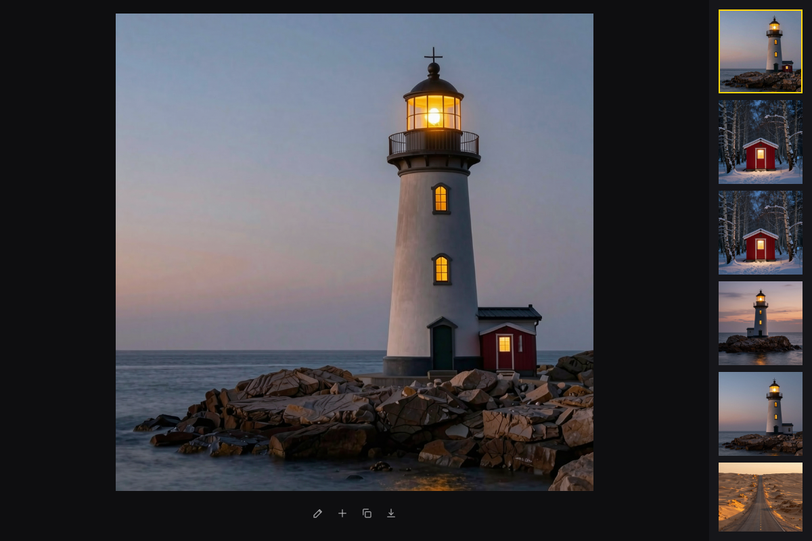

# Fantasi

Make images on your own machine with a local model, the way Omarchy runs them.



Describe an image, pick a size, and watch it sharpen step by step. Then change it: the next image starts from this one, keeping its composition while your prompt moves it. Or start from a picture of your own: open one, or drop it on the window. Every image lands in `~/Pictures/Generated` with its prompt and seed inside, so the history can show it again and make it again.

## Where the model comes from

Fantasi runs nothing itself. It asks [omarchy-local-ai](https://github.com/omacom/omarchy-local-ai), which runs Omarchy's local models, and follows what it says:

- An image model is running: Fantasi uses it.
- One is set up but stopped: Fantasi offers to start it.
- It is stopped because a text model holds the memory it needs: Fantasi offers to stop that model and start it.
- None is set up, but one runs on this machine: Fantasi offers to install it.
- None runs here: Fantasi says so, and why.

## Shortcuts

The prompt has the keyboard most of the time, so the shortcuts take Ctrl.

| Keys | Action |
| --- | --- |
| Enter | Make the image (Shift+Enter for a new line) |
| Esc | Stop making it, or go back to a new image |
| Ctrl+R | Make another like it |
| Ctrl+E | Change it: the next image starts from it |
| Ctrl+N | Start a new image |
| Ctrl+O | Start from a picture of your own |
| Ctrl+1, 2, 3 | Screen, square or portrait |
| Ctrl+B | Show or hide the history |
| Ctrl+Shift+C | Copy it |
| Ctrl+S | Save a copy somewhere else |
| Ctrl+Up, Ctrl+Down | Move through the history |
| Ctrl+Delete | Move it to the trash |
| F1 | Show or hide the shortcuts |
| Ctrl+Q | Quit |

Double-click an image in the history to take its prompt back into the panel.

## Command line

```sh
fantasi                                  # open the window
fantasi open "a calm lake at dusk"       # open it with a prompt
fantasi open --model flux2-klein-4b-sdcpp  # open it on that model, when it runs
fantasi generate "a calm lake at dusk" --width 1344 --height 768 --json
fantasi generate "the same lake under snow" --from ~/Pictures/Generated/lake.png
fantasi generate "the cabin from the first beside the lighthouse from the second" --from cabin.png --from lighthouse.png
fantasi skill install                    # teach your coding agents to make images
```

`fantasi generate` needs no display: it makes one image, prints where it saved it, and exits 0, or says why not on stderr and exits 1.

## Building

Fantasi is C++ and Qt Quick, built with CMake into one binary.

```sh
bin/build                               # build into build/
bin/test                                # build, then run the tests offscreen
cmake --install build --prefix ~/.local # try it in the app launcher
```

## License

Fantasi is released under the [MIT License](LICENSE). Its save dialog follows [Omacut](https://github.com/omacom/omacut)'s portal file picker (MIT).
